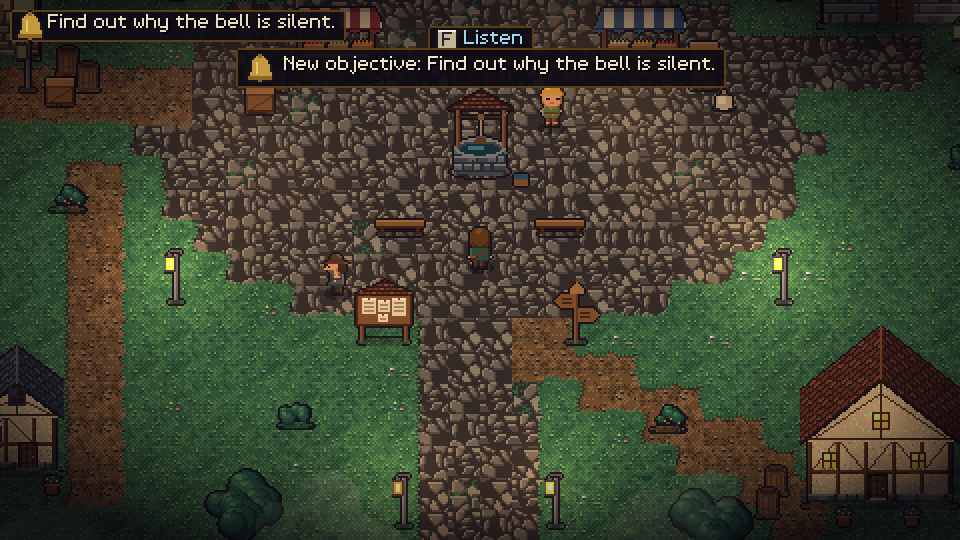

# The Thirteenth Bell

*Every night the bell saves the village. Every night, someone forgets why.*

A short medieval dark-fantasy mystery made in **Godot 4.7.2** (GDScript, Compatibility renderer). Rowan comes home to Dawnmere the night its bell falls silent and learns what the bell has been taking. There are five areas, an Echo ability for hearing the past, a seal puzzle, a guardian with two ways past it, and three endings. A first play takes about 10 to 20 minutes.



## Run it

1. Godot is at `C:\Users\user\Downloads\Godot_v4.7.2-stable_win64.exe\`.
2. Open the editor, choose **Import**, and select `project.godot` in this folder.
3. Press **F5** to play from the title screen. To test one area, open it in `scenes/world/` and press **F6**.

Run the tests (22 tests, about 30 s):

```powershell
& "C:\Users\user\Downloads\Godot_v4.7.2-stable_win64.exe\Godot_v4.7.2-stable_win64_console.exe" --headless --path . res://tests/test_runner.tscn
```

Run the visual tour, which plays through the whole game in a window and saves screenshots to `docs/screenshots/`:

```powershell
& "C:\Users\user\Downloads\Godot_v4.7.2-stable_win64.exe\Godot_v4.7.2-stable_win64_console.exe" --path . res://tests/tour.tscn
```

To build a Windows `.exe`, first install the templates via *Editor → Manage Export Templates → Download and Install*. Then use *Project → Export → Windows Desktop*; the preset is already configured.

## Controls

| Action | Keyboard | Gamepad |
|---|---|---|
| Move | WASD / arrow keys | D-pad / left stick |
| Interact | E | A |
| Listen to the Echo | F | X |
| Journal | J | Y |
| Advance dialogue | Enter / Space / E | A |
| Pause | Esc | Start |
| Fullscreen | F11 | |

Gamepad bindings are untested.

## Folder structure

```
project.godot            settings, input map, autoloads
scenes/world/            the five areas (village, forge, chapel, mist_path, bell_tower)
scenes/characters/       player.tscn, npc.tscn (one NPC scene for everyone)
scenes/interactables/    drop-in Interactable / EchoPoint / AreaExit / StoryTrigger
scenes/props/            82 props (each with sprite, collision, optional light)
scenes/ui/, scenes/main/ HUD, dialogue box, journal, menus, prologue, ending
scripts/autoload/        GameState, QuestManager, DialogueManager, SaveManager, ...
scripts/world/           game_area.gd (base) + one script per area
scripts/systems/         seal_puzzle.gd, mist_pulse.gd
data/                    ALL story content as JSON (dialogue, quests, documents, endings, flags)
assets/                  generated art, font, shaders, audio
tests/                   test runner, 5 suites, visual tour
tools/                   Python generators for art, scenes and audio (ignored by Godot)
docs/                    GAME_DESIGN, ARCHITECTURE, QA_REPORT, NEXT_STEPS, screenshots
```

For how the pieces fit together, see [docs/ARCHITECTURE.md](docs/ARCHITECTURE.md).

## How to…

**Add dialogue.** Edit `data/dialogue/*.json`. A conversation is a list of steps:

```json
"baker": [
	{"if": "met_baker", "goto": "again"},
	["baker", "Bread's fresh. Memories, less so."],
	{"choice": [
		{"text": "I'll take a loaf.", "set": {"bought_bread": true}, "goto": "buy"},
		{"text": "Just looking.", "goto": "bye"}
	]},
	{"label": "buy"}, ["baker", "Two coins."], {"end": true},
	{"label": "bye"}, {"set": {"met_baker": true}},
	{"label": "again"}, ["baker", "Back again?"]
]
```

- **Steps:** a line `[speaker, text]`, `choice`, `label`, `goto`, `set`, `event`, `wait`, `run`, `end`.
- **Any step** can carry an `"if"` condition.
- **Line text** supports BBCode (`[wave]`, `[color]`) and `{p}` for a short pause.
- **Speakers** live in `data/speakers.json`.
- **New flags** go in `data/flags.json`, or the tests fail (that catches typos).

**Add an NPC.** Instance `scenes/characters/npc.tscn` under an area's `Objects` node and set its exports:
- `sprite_frames`: a `SpriteFrames` with `idle_*` / `walk_*` animations.
- `conversation`, `facing_name`, and optionally `wander_radius`.
- `spectral`, for a ghost.
- `present_when`, so it only appears while a condition holds.

**Add an interaction.** Instance `scenes/interactables/interactable.tscn`, or `echo_point.tscn` for an F-reveal, under `Interactions`, then set:
- `conversation_id` and `prompt`.
- `requires` / `hidden_when` conditions.

For custom behaviour, connect to its `interacted` signal in the area script.

**Add an area.**
1. Duplicate an area scene; keep the node layout described in `scripts/world/game_area.gd`.
2. Set `area_id`, `display_name`, `music`, `ambience` and `bounds`.
3. Register the scene in `GameState.AREAS`.
4. Add `Spawns/<name>` markers.
5. Connect areas with `AreaExit` nodes (`target_area` + `target_spawn`).

**Add a quest step.** Add an objective to `data/quests/quests.json` with `start` and `done` conditions. Add journal entries under `discoveries` with a `when` condition. Nothing else is needed: progress is derived from flags.

**Add an ending.**
1. Add it to `data/endings.json` (title, lines, epilogue lines).
2. Add a choice that sets `ending_selected` and fires the `ending` event (see `orin_decide` in `data/dialogue/tower.json`).
3. Add its visual sequence to `scripts/ui/ending.gd` and `scripts/world/bell_tower.gd`.

**Change art or audio.** Replace a PNG or WAV with the same name and size. To regenerate everything (needs Python 3 with Pillow, NumPy and SciPy), run:

```powershell
cd tools\art; python tiles.py; python characters.py; python props.py; python ui_art.py
cd ..\build; python build_resources.py; python build_ui.py; python levels.py
cd ..\audio; python generate_audio.py
```

⚠️ `levels.py` rewrites the five area scenes, so skip it once you've edited areas in the editor.

## Status

- **Working and tested:** the complete game from the title screen to all three endings, with save/load, settings, and original pixel art and audio. 22 automated tests pass, including three end-to-end playthroughs on the real scenes, and a windowed tour of the whole game ran with no errors.
- **Not yet done:**
  - Nobody has played it by hand yet.
  - Nobody has listened to the generated audio.
  - No `.exe` has been built (export templates aren't installed).

See [docs/QA_REPORT.md](docs/QA_REPORT.md) for details and a playtest checklist, and [docs/NEXT_STEPS.md](docs/NEXT_STEPS.md) for the road ahead and Git tips for working as two.
